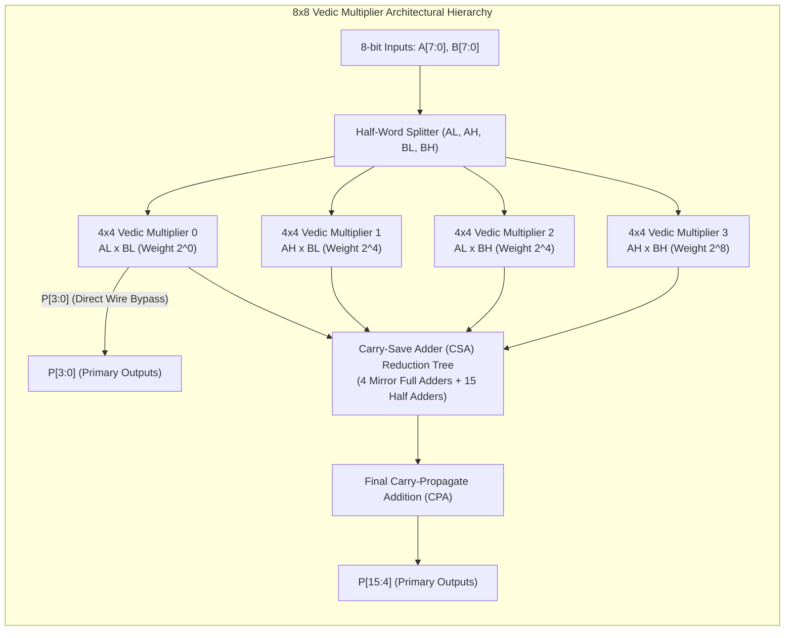
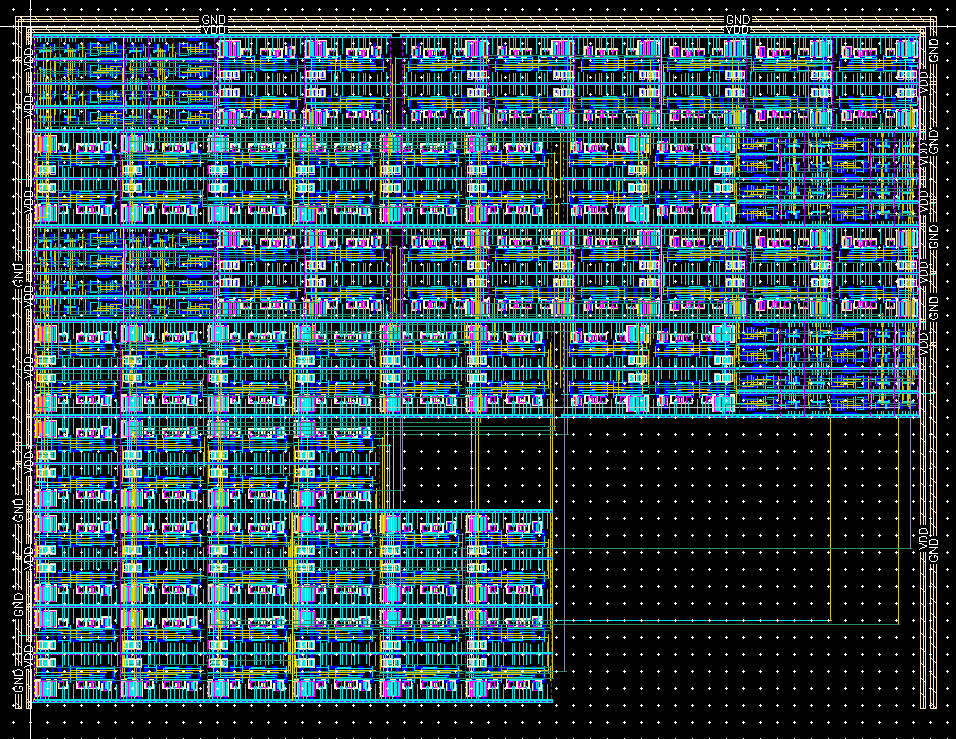
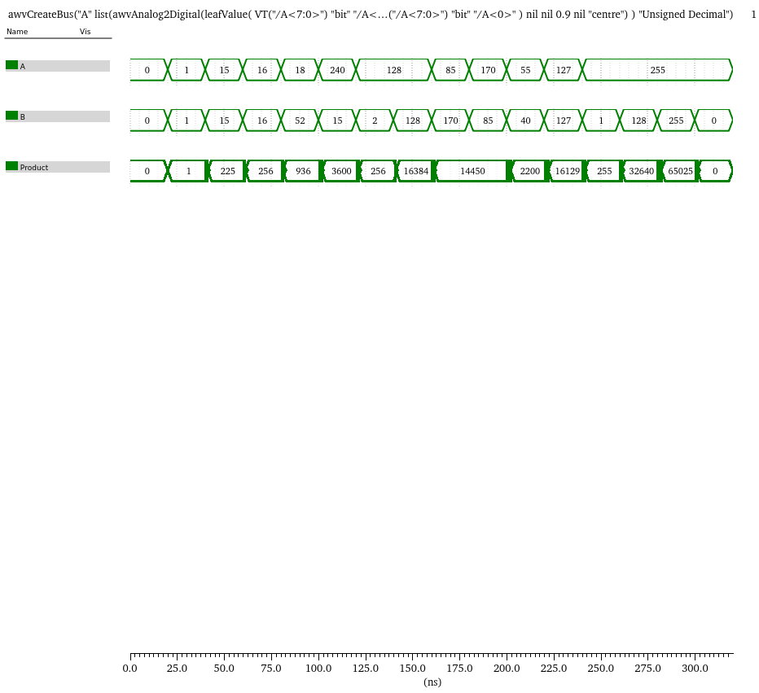

# 8×8 Urdhva Tiryakbhyam CMOS Vedic Multiplier
### Transistor-Level Schematic Optimization & Full-Custom Physical Layout in 180nm CMOS

[](https://www.cadence.com/)
[](https://www.cadence.com/)
[](#full-custom-physical-layout--drc-considerations)
[](#technologies--tools-used)
[](#full-custom-physical-layout--drc-considerations)
[](reports/)
[](https://www.iitg.ac.in/eee/)

---

## Executive Summary

This repository presents the end-to-end design, transistor-level schematic capture, algorithmic hardware optimization, and full-custom physical layout of an **$8\times 8$ unsigned binary Vedic Multiplier** ($\mathbf{A}[7:0] \times \mathbf{B}[7:0] \to \mathbf{P}[15:0]$) implemented in a **180nm CMOS process ($V_{DD} = 1.8\,\text{V}$)** using the **Cadence Virtuoso** custom IC design suite.

Based on the ancient Indian *Urdhva Tiryakbhyam* ("Vertically and Crosswise") sutra, this architecture generates all partial products concurrently and performs parallel column-weight reduction. By replacing conventional cascading Ripple Carry Adders (RCA) with **Carry-Save Adder (CSA) compression trees** and custom **AOI22 (AND-OR-Invert)** compound logic, this design achieves:
* **43.4% reduction in total transistor count** ($3,456\text{T} \to 1,956\text{T}$)
* **30.9% savings in average dynamic power dissipation** ($227.6\,\mu\text{W} \to 157.3\,\mu\text{W}$)
* **17.0% improvement in worst-case critical path delay** ($2.71\,\text{ns} \to 2.25\,\text{ns}$)
* **Standard-pitch modular layout footprint** spanning **$271.11\,\mu\text{m} \times 203.67\,\mu\text{m}$ ($0.0552\,\text{mm}^2$)** with 100% DRC/LVS clearance.

Developed at the **Department of Electronics and Electrical Engineering, Indian Institute of Technology Guwahati (IIT Guwahati)** by **Yash** (M.Tech EEE, Roll: `264102418`).

---

## Key Performance Benchmarks

All parameters were simulated in **Cadence Spectre** at nominal conditions ($V_{DD} = 1.8\,\text{V}$, $T = 27^\circ\text{C}$, 180nm CMOS technology) across 100 sampled pseudo-random test vectors including critical corner cases ($0 \times 0$, $255 \times 0$, $255 \times 255 = 65,025_{10}$).

### Conventional (RCA) vs. Optimized (CSA + AOI) Hardware Metrics

| Design Metric | Conventional 8×8 Vedic Multiplier | Optimized Carry-Save 8×8 Vedic Multiplier | Quantitative Benefit |
| :--- | :---: | :---: | :---: |
| **Summation Architecture** | Multi-bit Ripple Carry Adders (RCA) | Carry-Save Adder (CSA) Tree + AOI22 Logic | **Eliminated Carry Ripple** |
| **$2\times 2$ Subblock Count** | 48 Transistors (4 AND2 + 2 HA) | **38 Transistors** (AOI22 + NAND3 + INV) | **-20.8% Leaf Cell Area** |
| **$4\times 4$ Subblock Count** | 640 Transistors (4 $2\times 2$ + 3 RCAs) | **372 Transistors** (4 $2\times 2$ + 4 Mirror FA + 7 HA) | **-41.9% Sub-block Count** |
| **$8\times 8$ Total Transistors** | **3,456 Transistors** | **1,956 Transistors** | **-43.4% Hardware Reduction** |
| **Average Power Dissipation** | **227.6 µW** | **157.3 µW** | **-30.9% Energy Savings** |
| **Worst-Case Delay ($t_{\text{pd}}$)** | **2.71 ns** | **2.25 ns** | **-17.0% Critical Path Speedup** |
| **Power-Delay Product (PDP)** | **616.8 fJ** | **353.9 fJ** | **-42.6% Energy-Efficiency Gain** |
| **Layout Total Die Area** | — | **$271.105\,\mu\text{m} \times 203.67\,\mu\text{m}$ ($0.0552\,\text{mm}^2$)** | **Standard-Pitch Layout** |
| **Functional Verification** | 100/100 Test Cases Passed | 100/100 Test Cases Passed | **100% Arithmetic Exactness** |

---

## Repository File Structure

```
8x8-vedic-multiplier-cmos/
├── README.md                                       # Primary project portal and documentation
├── .gitignore                                      # Cadence, Spectre, and LaTeX ignore rules
│
├── assets/                                         # High-resolution architectural figures & waveforms
│   ├── block_diagrams/                             # Hierarchical architecture block diagrams
│   │   ├── 2x2_con_block.png, 2x2optimized_blockdigram.png
│   │   ├── 4x4_conventional_block.png, 4x4_optimized_block.png
│   │   └── 8x8_conventional_block.png, 8x8_optimized_block1.png
│   ├── circuits/                                   # Cadence Virtuoso gate-level schematics
│   │   ├── 2x2_ciruit.png, 2x2_opt__ciruit.png
│   │   ├── 4x4_ciruit.png, 4x4_opt__ciruit.png
│   │   └── 8x8_ciruit.png, 8x8_opt__ciruit.png
│   ├── schematics/                                 # Transistor-level leaf cell schematics
│   │   ├── modified_AOI.png                        # Compound AOI22 cell (P1 sum logic)
│   │   ├── TG_HA_ciruit.png                        # 12T Transmission-Gate Half Adder
│   │   └── mirror_full_adder.png                   # 24T Mirror Full Adder cell
│   ├── layout/                                     # Cadence Virtuoso Layout XL captures
│   │   ├── leaf_and_layout.png, leaf_and_sch.png   # Standard-pitch AND2 cell
│   │   ├── leaf_halfader_layout.png, leaf_halfader_sch.png # 7µm pitch Half Adder
│   │   ├── leaf_mirror_adder_layout.png, leaf_mirror_adder_sch.png # 14µm pitch Mirror Adder
│   │   ├── 22_layout.png                           # 2x2 Vedic sub-multiplier layout
│   │   ├── 44_layout.png                           # 4x4 Vedic sub-multiplier layout
│   │   └── 88_layout.png                           # Full 8x8 top die layout (0.0552 mm²)
│   └── plots/                                      # Transient simulation waveforms
│       └── 8x8_output_bus_opt.png                  # 16-bit output bus settling waveform
│
├── docs/                                           # Theoretical, algorithmic & schematic guides
│   ├── Bit_Column_Matrix_Representation.md         # Dot diagrams and partial product compression
│   └── Master_Schematic_Blueprint.md               # Cadence Virtuoso schematic capture guide
│
├── reports/                                        # Publication-Quality Academic Reports (PDFs)
│   ├── 8x8_Vedic_Multiplier_Architecture_Report.pdf  # Compiled Architecture & Simulation PDF (13 pages)
│   └── 8x8_Vedic_Multiplier_Physical_Layout_Report.pdf # Compiled Physical Layout Report PDF (14 pages)
│
└── simulation/                                     # Digital & analog verification
    ├── lablast.circ                                # Logisim-Evolution gate-level circuit verification
    └── fulladder.vec                               # Digital stimulus test vector
```

---

## Mathematical Principle: Urdhva Tiryakbhyam

The *Urdhva Tiryakbhyam* sutra evaluates all partial product terms concurrently and maps them directly into their arithmetic column weights. For an $N$-bit multiplier, operands $\mathbf{A}$ and $\mathbf{B}$ are split into upper and lower half-words of width $M = N/2$:

$$\mathbf{A} = 2^M \mathbf{A}_{\text{H}} + \mathbf{A}_{\text{L}}, \quad \mathbf{B} = 2^M \mathbf{B}_{\text{H}} + \mathbf{B}_{\text{L}}$$

Multiplying the algebraic expansion yields four $(N/2)\times(N/2)$ sub-products:

$$\mathbf{P} = \mathbf{A} \times \mathbf{B} = 2^N (\mathbf{A}_{\text{H}} \mathbf{B}_{\text{H}}) + 2^M (\mathbf{A}_{\text{H}} \mathbf{B}_{\text{L}} + \mathbf{A}_{\text{L}} \mathbf{B}_{\text{H}}) + (\mathbf{A}_{\text{L}} \mathbf{B}_{\text{L}})$$

Defining:
$$Q_0 = \mathbf{A}_{\text{L}} \times \mathbf{B}_{\text{L}}, \quad Q_1 = \mathbf{A}_{\text{H}} \times \mathbf{B}_{\text{L}}, \quad Q_2 = \mathbf{A}_{\text{L}} \times \mathbf{B}_{\text{H}}, \quad Q_3 = \mathbf{A}_{\text{H}} \times \mathbf{B}_{\text{H}}$$

The composite 16-bit product $\mathbf{P}[15:0]$ is synthesized as:
$$\mathbf{P} = 2^8 Q_3 + 2^4 (Q_1 + Q_2) + Q_0$$

### Bit-Column Matrix & Dot Diagram Alignment

```
Arithmetic Weight:  2^7     2^6     2^5     2^4     2^3     2^2     2^1     2^0
Column Index (k):    7       6       5       4       3       2       1       0
---------------------------------------------------------------------------------
q0[3:0]:                                            q0[3]   q0[2]   q0[1]   q0[0]  --> P[1:0] Direct Bypass!
q1[3:0]:                            q1[3]   q1[2]   q1[1]   q1[0]
q2[3:0]:                            q2[3]   q2[2]   q2[1]   q2[0]
q3[3:0]:            q3[3]   q3[2]   q3[1]   q3[0]
---------------------------------------------------------------------------------
Column Height:       1       1       3       3       3       3       1       1
```

> **Key Architectural Insight (Zero-Delay Direct LSB Bypass):**  
> Notice that for columns $k = 0$ and $k = 1$, the partial product column heights are exactly $1$. The lower $N/2$ bits of sub-product $Q_0$ undergo **no arithmetic addition whatsoever** and are hardwired directly to primary outputs $P[N/2-1 : 0]$ with **zero gate delay and zero dynamic switching power**!

---

## Hierarchical Hardware Architecture



### 1. Atomic $2\times 2$ Vedic Leaf Multiplier (`2x2_VEDIC_AOI`)
* **Conventional Implementation (48T):** 4 static CMOS AND2 gates ($4 \times 6\text{T} = 24\text{T}$) + 2 Half Adders ($2 \times 12\text{T} = 24\text{T}$).
* **Optimized AOI Implementation (38T):**
  * $P_0 = A_0 B_0$ generated via NAND2 + Inverter (6T).
  * $P_1 = (A_1 B_0) \oplus (A_0 B_1)$ synthesized via a custom **AOI22 compound gate** (`modified_AOI.png`), avoiding XOR overhead.
  * $P_2$ cross-carry cancellation: evaluates $P_2 = (A_1 B_1) \cdot \overline{P_0}$, eliminating an entire Half Adder.
  * $P_3 = (A_1 B_1) \cdot (A_0 B_0)$ generated via a single 3-input NAND gate.
  * **Result:** 38 Transistors (**20.8% reduction**).

### 2. Primitive Adder Cells
* **12T Transmission-Gate Half Adder (`TG_HA`):** Uses complementary CMOS transmission gates to generate Sum ($A \oplus B$) and Carry ($A \cdot B$) with balanced propagation delay and compact silicon layout.
* **24T Mirror Full Adder (`Mirror_FA`):** Employs symmetric complementary pull-up/pull-down networks for Carry generation. Eliminates inverted carry stages and cuts carry propagation delay ($C_{\text{in}} \to C_{\text{out}}$) down to **$63.4\,\text{ps}$** compared to $153.8\,\text{ps}$ in conventional 28T full adders.

### 3. $4\times 4$ and $8\times 8$ Carry-Save Reduction Trees
* **Conventional Architecture:** Employs three wide Ripple Carry Adders (one $N$-bit RCA, two $3N/2$-bit RCAs). Carries ripple sequentially through $2N$ adder stages, creating an expansive critical delay path.
* **Optimized Architecture:** Replaces RCAs with a two-step Carry-Save Adder (CSA) reduction tree:
  1. **Parallel Compression:** Sums columns of identical arithmetic weights in parallel using Mirror Full Adders and Half Adders, generating separate sum and carry vectors without rippling.
  2. **Short Vector Merge:** Carries propagate only across the short final ripple stage.

---

## Full-Custom Physical Layout & DRC Considerations

The physical layout was drafted in **Cadence Virtuoso Layout Suite XL** following foundry DRC rules:

<p align="center">
  
  <br>
  <em>Figure: Full-custom physical layout of the 8×8 Urdhva Tiryakbhyam Vedic Multiplier in Cadence Virtuoso Layout XL.</em>
</p>

### Layout Pitch-Matching & Floorplanning Strategy
* **Standard Cell Pitch Grid:** To eliminate whitespace routing overhead and achieve compact rectangular tile abutment, all leaf cells were engineered with a standard pitch of **$7\,\mu\text{m}$**:
  * 2-Input AND Gate: $7\,\mu\text{m}$ height ($1\times$ pitch)
  * Transmission-Gate Half Adder: $7\,\mu\text{m}$ height ($1\times$ pitch)
  * Mirror Full Adder: $14\,\mu\text{m}$ height ($2\times$ pitch)
* **Die Dimensions:**
  $$\text{Width} = 271.105\,\mu\text{m}, \quad \text{Height} = 203.670\,\mu\text{m} \implies \mathbf{\text{Total Silicon Area} = 0.0552\,\text{mm}^2}$$
* **DRC Clearance Rules Enforced:**
  * Minimum N-Well to NPOD ($N^+$ active diffusion) spacing: $\ge 0.43\,\mu\text{m}$.
  * Strict vertex and via snapping to manufacturing grid to eliminate off-grid points.
  * Robust, continuous Metal-1/Metal-2 VDD and GND power grid rings to suppress electromigration and $IR$ drop across high switching transitions.

---

## Transient Simulation & Verification

<p align="center">
  
  <br>
  <em>Figure: Cadence Spectre transient waveform showing 8-bit input buses A[7:0], B[7:0] and settling of the 16-bit product bus P[15:0].</em>
</p>

* **Functional Validation:** 100 random multi-bit vectors were continuously fed into the simulation testbench. The product bus settled accurately without glitching or logic errors.
* **Corner Verification:** Verified maximum positive arithmetic boundary:
  $$\mathbf{A} = 255_{10} \, (11111111_2), \quad \mathbf{B} = 255_{10} \, (11111111_2) \implies \mathbf{P} = 65{,}025_{10} \, (1111111000000001_2)$$

---

## Academic Reports & Publications

The complete mathematical derivations, schematic captures, and DRC/LVS layout books are compiled in two comprehensive academic PDFs:

1. **[8×8 Vedic Multiplier Architectural Design Report (PDF)](reports/8x8_Vedic_Multiplier_Architecture_Report.pdf)**  
   *Comprehensive 13-page report detailing Urdhva Tiryakbhyam theory, dot diagrams, CSA compression trees, Spectre simulations, and power/delay trade-offs.*
2. **[8×8 Vedic Multiplier Physical Layout Report (PDF)](reports/8x8_Vedic_Multiplier_Physical_Layout_Report.pdf)**  
   *14-page physical design report detailing leaf cell floorplanning, standard-pitch layout matching, DRC/LVS clearance rules, and die photomicrographs.*

---

## Author & Academic Information

* **Designer:** Yash
* **Roll Number:** 264102418
* **Program:** Master of Technology (M.Tech) in Electrical and Electronics Engineering
* **Department:** Department of Electronics and Electrical Engineering (EEE)
* **Institution:** Indian Institute of Technology Guwahati (IIT Guwahati), Assam, India
* **Course:** Digital Integrated Circuits (DIC) Laboratory
